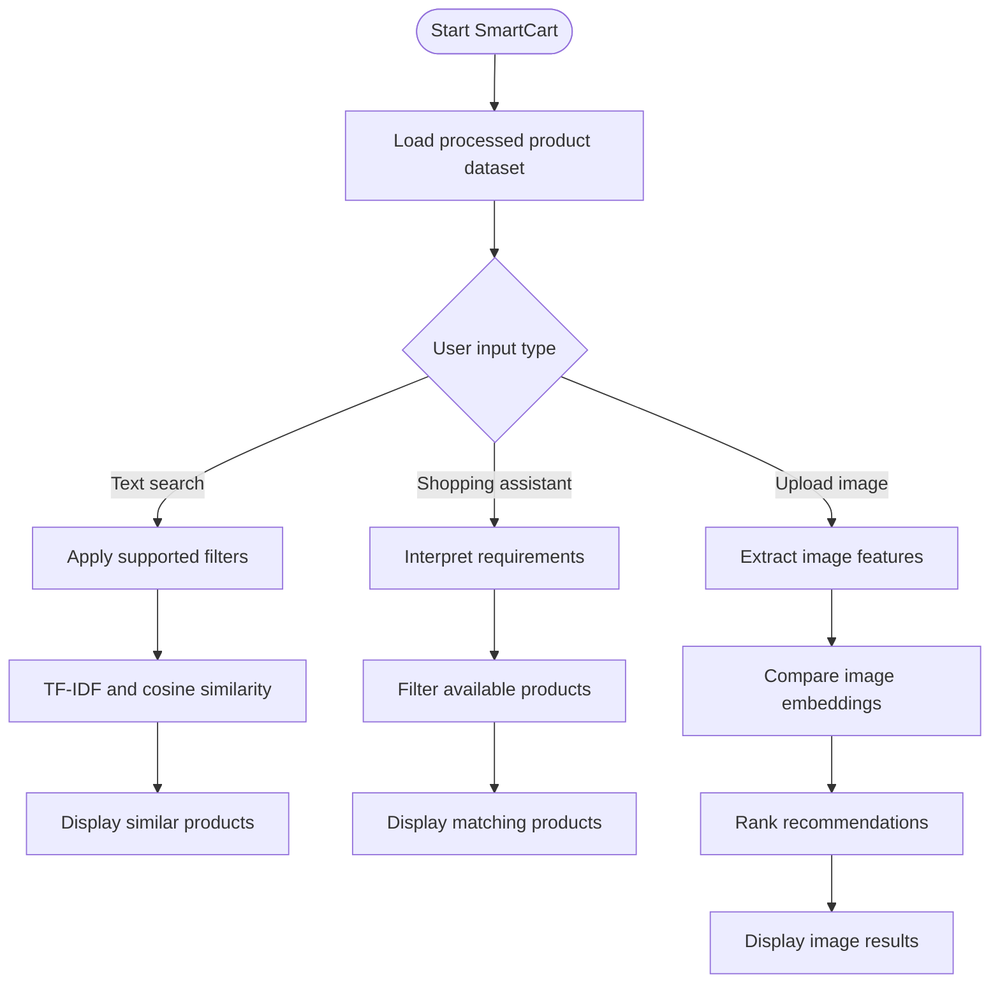

# SmartCart - Product Recommendation System

## Live Demo

🚀 **[Launch SmartCart](https://smartcart-online.streamlit.app/)**

## 1. Project Overview

SmartCart is a product recommendation system designed to help users discover relevant products across multiple product categories and e-commerce datasets. It uses product information, recommendation algorithms, filtering, and image-based similarity to support product discovery.

The project is developed by a team of four members, with each member responsible for a specific component, including product data preparation, recommendation modeling, shopping assistance and personalization, and image similarity with the application interface.

## 2. Objectives

- Organize product information from available e-commerce datasets.
- Recommend relevant products based on product features and similarity.
- Allow product discovery using category, platform, product type, and other available attributes.
- Explore natural-language shopping queries through a rule-based assistant.
- Support image-based product similarity.
- Provide an accessible interface for exploring recommendations.

## 3. Key Features

- **Product data processing:** Cleaning and combining available product datasets.
- **Content-based recommendations:** Finding similar products using textual product features.
- **Top-N recommendations:** Returning a limited list of relevant products.
- **Product filtering:** Narrowing results using supported product attributes and user constraints.
- **Shopping assistant:** Interpreting supported shopping queries using rule-based logic.
- **Personalization:** Using configured preferences and recorded search or click history where supported.
- **Image similarity:** Comparing product images using image feature representations.
- **Streamlit interface:** Providing an interactive application for product discovery.


## 4. Technology Stack

- **Programming language:** Python
- **Data processing:** Pandas, NumPy
- **Recommendation modeling:** Scikit-learn TF-IDF and cosine similarity
- **Application interface:** Streamlit
- **Image processing and feature extraction:** MobileNetV3 Small and supporting image-processing libraries
- **Data storage:** CSV and JSON files
- **Version control:** Git and GitHub

## 5. Project Structure

```text
SmartCart/
├── app.py
├── README.md
├── requirements.txt
├── .gitignore
├── .gitattributes
│
├── data/
│   ├── cleaned_datasets.zip
│   └── processed/
│       └── master_products.csv
│
├── image_recommendation/
│   ├── generate_embeddings.py
│   ├── image_search.py
│   ├── integrated_recommender.py
│   └── test_multiple_categories.py
│
├── models/
│   └── content_based_recommender.py
│
├── outputs/
│   └── image_recommendation/
│       ├── product_embeddings.npy
│       └── product_metadata.csv
│
└── scripts/
    ├── ai_shopping_assistant.py
    ├── build_master_dataset.py
    ├── check_cleaned_data.py
    ├── check_duplicate_ids.py
    ├── clean_amazon_beauty.py
    ├── clean_amazon_fashion.py
    ├── clean_amazon_laptops.py
    ├── clean_amazon_mobiles.py
    ├── clean_amazon_shoes.py
    ├── clean_flipkart.py
    ├── clean_flipkart_mobile_new.py
    ├── clean_myntra.py
    ├── clean_myntra_shoes.py
    ├── clean_nykaa.py
    ├── member3_assistant.py
    ├── personalization.py
    ├── prepare_flipkart_laptops.py
    └── standardize_all_datasets.py
```


## 6. Team Contributions

### Member 1 - Data Collection and Database Preparation

**Responsibilities:**
- Collect and organize available product datasets.
- Prepare product data from supported e-commerce sources.
- Clean and standardize product attributes.
- Handle missing values and inconsistent product information where applicable.
- Combine processed datasets into a master product dataset.
- Support the other modules by providing structured product data.

**Key output:** Processed product datasets and `data/processed/master_products.csv`.

### Member 2 - Recommendation Modeling

**Responsibilities:**
- Develop the content-based recommendation approach.
- Convert product text into numerical features using TF-IDF.
- Calculate similarity between products using cosine similarity.
- Support filtering by category, platform, and product type where implemented.
- Return Top-5 or other configured numbers of relevant product recommendations.

**Key output:** Content-based recommendation and similarity-ranking logic.

**Important:** The final project documentation describes content-based recommendation separately. It does not claim that a hybrid recommendation model is part of the final application.

### Member 3 - AI Shopping Assistant and Personalization

**Responsibilities:**
- Develop rule-based processing for supported natural-language shopping queries.
- Extract product requirements such as brand, category, budget, and other supported attributes.
- Filter product results according to the interpreted requirements.
- Store and apply configured user preferences where supported.
- Maintain search and click history using the project's history files.

**Key output:** `ai_shopping_assistant.py`, `personalization.py`, `user_history.py`, and `member3_assistant.py`.

The assistant and personalization components are documented as separate modules; their availability in the deployed interface depends on the final integration.

### Member 4 - Image Similarity and Application Interface

**Responsibilities:**
- Develop image-based product similarity functionality.
- Use MobileNetV3 Small to extract image features where implemented.
- Compare image feature representations to identify visually similar products.
- Support product discovery through the Streamlit interface.
- Work on displaying product details and image-based results.

**Key output:** Image feature extraction, image-similarity functionality, and Streamlit interface components.


## 7. Recommendation Workflow




 
## 8. Dataset

The project uses available product datasets from multiple e-commerce sources and categories. Processed data is organized into cleaned datasets and a master product file.

Example processed file:

`data/processed/master_products.csv`

The master dataset contains product records assembled by the project's data-processing pipeline. Product availability, attributes, ratings, prices, and image links depend on the source datasets and their completeness.

## 9. Installation and Setup

### Prerequisites

- Python 3.10 or a compatible Python version supported by the installed dependencies
- Git
- pip

### Clone the repository

```bash
git clone <YOUR_GITHUB_REPOSITORY_URL>
cd Product-Recommendation-System
```

Replace the placeholder with the actual repository URL.

### Create a virtual environment

```bash
python -m venv .venv
```

Activate it on Windows:

```powershell
.venv\Scripts\activate
```

### Install dependencies

```bash
pip install -r requirements.txt
```

### Run the application

If the Streamlit entry point is `app.py`, run:

```bash
streamlit run app.py
```

If your repository uses a different entry-point filename, replace `app.py` with the correct filename.

## 10. Testing and Validation

The project can be validated by checking:

- Whether the processed product dataset loads successfully.
- Whether product filters return matching products.
- Whether content-based recommendations return relevant results.
- Whether the shopping assistant handles supported queries.
- Whether preference and history files are read and updated correctly.
- Whether image features and similarity results are produced.
- Whether the Streamlit application displays the available product information correctly.


## 11. Current Limitations

- Product coverage depends on the available datasets.
- Missing or incomplete product images may affect image-based results.
- Rule-based query interpretation is limited to supported patterns and attributes.
- Some standalone modules may require additional integration with the main application.
- Recommendation quality depends on the quality and completeness of product information.

## 12. Future Enhancements

- Improve product image availability and display.
- Expand support for natural-language shopping queries.
- Improve product metadata quality and filtering.
- Integrate the individual modules into a more consistent user workflow.
- Add further evaluation of recommendation relevance.
- Improve performance and usability as the product dataset grows.

## 13. Team

This project is developed by a four-member team:

- **Member 1:** Data Collection and Database Preparation
- **Member 2:** Recommendation Modeling
- **Member 3:** AI Shopping Assistant and Personalization
- **Member 4:** Image Similarity and Application Interface

## 14. Conclusion

SmartCart brings together product data processing, content-based recommendation, shopping assistance, personalization, and image similarity in a product discovery project. Its modular structure allows the team to develop and evaluate individual components while working toward a unified shopping experience.
